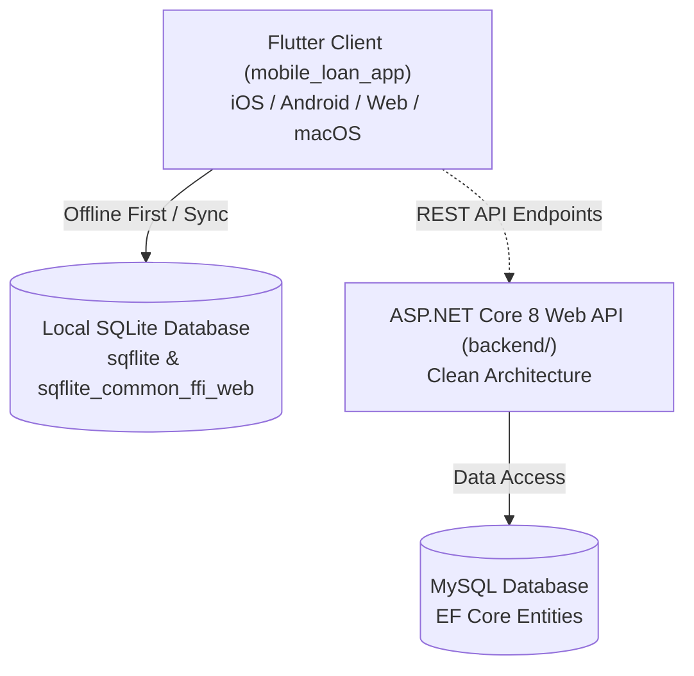

# PROJECT_CONTEXT.md - Sri Meenakshi Finance Loan Management System

## 1. Project Purpose & Domain
**Sri Meenakshi Finance** is a specialized financial software application crafted for micro-finance firms, chit fund managers, and daily/weekly loan collectors in Tamil Nadu. It replicates and digitizes traditional paper-ledger workflows (கைசிட்டை / நோட்டு வசூல்), passbook logs, and collection registers into a modern, responsive cross-platform software system.

---

## 2. System Architecture



### Directory Structure & Responsibilities
```
loan_management_system/
├── mobile_loan_app/                     # Flutter Cross-Platform Frontend
│   ├── lib/
│   │   ├── main.dart                    # App Entrypoint & Web SQLite setup
│   │   ├── app/
│   │   │   ├── app.dart                 # Navigation shell, authentication state & financial year
│   │   │   └── theme/                   # Custom design system & color scheme
│   │   ├── core/
│   │   │   ├── models/                  # LoanModel, CustomerModel, CollectionModel, UserModel, LineModel
│   │   │   ├── services/
│   │   │   │   ├── database_helper.dart # SQLite DB schema & CRUD methods
│   │   │   │   ├── loan_repository.dart # Business logic, caching, calculation, role security
│   │   │   │   └── passbook_service.dart# PDF & HTML Passbook generation
│   │   │   └── utils/                   # Currency formatters, date formatters
│   │   └── features/
│   │       ├── auth/                    # Login & Financial Year selector
│   │       ├── dashboard/               # Action tile grid, brand header (Aven schmith)
│   │       ├── loans/                   # Loan forms, Balance view, Bond lookup, Passbook, Owner capital
│   │       ├── collections/             # Fast daily collection entry (Cash / Gpay) & Sheet view
│   │       └── reports/                 # Scheme registers, dynamic dates & Account Breakdown table
├── backend/                             # .NET 8 Web API
│   ├── backend_for_loan_app.API/        # REST Controllers (Loans, Customers, Collections, Reports)
│   ├── backend_for_loan_app.Application/# Application logic and service contracts
│   ├── backend_for_loan_app.Domain/     # Core domain entities (Loan, Customer, DailyCollection, CollectionLine)
│   └── backend_for_loan_app.Infrastructure/ # EF Core Context & MySQL integration
├── install_on_iphone.sh                 # iPhone USB direct deployment helper
├── install_on_phone.sh                  # Android deployment helper
└── README.md                            # High-level repository documentation
```

---

## 3. Key Concepts & Business Logic

### A. Line & Bond Numbering
- Loans and customers are partitioned into **Lines** (`Line A`, `Line B`, `Line C`, `Line D`).
- Every active loan has a formatted **Bond Number** (`Line-Number`, e.g., `A-001`, `B-042`).
- Searching by bond prefix or raw number automatically resolves the borrower's details.

### B. User Roles & Access Control
- **நிர்வாகி (Admin)**:
  - Can create new loans (`LoanFormPage`).
  - Can record daily collections (`DailyCollectionPage`).
  - Can delete or edit loans, customers, and payments.
  - Full access to financial analytics and owner capital views.
- **கடன் வழங்குநர் (Lender)**:
  - Read-only on monetary entries.
  - Can view reports, passbooks, and balance sheets.
  - Permitted to perform member information corrections (`EditingPage`).

### C. Bilingual UI (Tamil & English)
- Fully dynamic language toggle (`isTamil`).
- Field labels, receipt names, payment methods, and error dialogues are localized in clear colloquial terminology.

### D. Payment Modes
- **ரொக்கம் (Cash)**: Standard cash receipts.
- **Gpay**: Digital UPI payments; automatically tracks online volume and flags target customer status.

### E. Financial Year Isolation
- Accounts are segmented by Financial Year (e.g., `2024-2025`, `2025-2026`) preventing cross-year calculation pollution.

---

## 4. Key UI Pages & Workflows

| Page | File | Purpose |
|---|---|---|
| **Dashboard** | `features/dashboard/presentation/dashboard_page.dart` | Grid of action tiles with role guards and brand header. |
| **New Loan** | `features/loans/presentation/loan_form_page.dart` | Loan creation, tenure calculation, interest/document charge rules, photo upload. |
| **Daily Collection** | `features/collections/presentation/daily_collection_page.dart` | Speedy installment entries (`Cash`/`Gpay`), auto-next bond flow, daily sheet (`இன்றைய பட்டியல்`). |
| **Balance View** | `features/loans/presentation/balance_view_page.dart` | Comprehensive customer lookup, balance lists, proof/Aadhaar preview. |
| **Loan Passbook** | `features/loans/presentation/loan_passbook_page.dart` | Chronological debit/credit history, previous vs. remaining balances, PDF print. |
| **Owner Capital** | `features/loans/presentation/owner_capital_page.dart` | Total invested funds, collection receipts, cash in hand, line-wise outstanding. |
| **Scheme Analytics** | `features/reports/presentation/widgets/ledger_analytics_widget.dart` | Dynamic date-by-date progressive collection ledger and Account Breakdown table (`Acc No`, `Interest Amnt`, `Document Charge`, `Total`). |
| **Editing & Corrections** | `features/collections/presentation/editing_page.dart` | Correct customer names, phone numbers, addresses, and line allocations. |

---

## 5. Technology Stack & Packages

- **Frontend Framework**: Flutter 3.24+ / Dart 3.11+
- **Database**:
  - Native: `sqflite` (SQLite)
  - Web: `sqflite_common_ffi_web` (Wasm-compatible SQLite in browser)
- **Networking**: `dio` (ready for backend synchronization)
- **Backend**: ASP.NET Core 8 Web API (.NET 8), Entity Framework Core, Pomelo MySQL provider.
- **Utilities**: `intl`, `share_plus`, `path_provider`, `image_picker`.

---

## 6. How to Run & Test

### Run Flutter Client on Web (Chrome):
```bash
cd mobile_loan_app
flutter run -d chrome --web-port=8080
```

### Run Flutter Client on iOS / iPhone:
```bash
./install_on_iphone.sh
```

### Run Backend API:
```bash
cd backend/backend_for_loan_app.API
dotnet run
```
